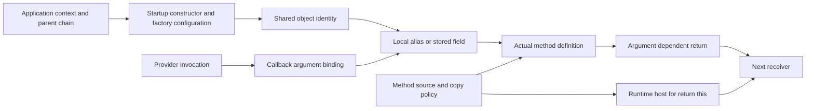

# Resolution relationships: research and implementation plan

Current implementation checkpoint: [implementation status](RESOLUTION-IMPLEMENTATION-STATUS.md).
The user has authorized implementation; research-only statements below describe
the earlier checkpoint. Only the explicitly recorded contracts are implemented.

Research checkpoint: 2026-10-09. This is a source investigation and plan, not a
resolver change or a new reduction claim. It uses the automatic seven-corpus
baseline in `target/resolution/pattern-final`, including the explicit Wheels
vendor root. Source/configuration and indexed/scanned coverage remain unchanged.
These extracted local sources differ from the historical pinned reports.

Current direction: investigate the runtime rules before further implementation.
[Research coverage and the next plan](RESOLUTION-RESEARCH-COVERAGE.md) measures
the selected families across all seven reports and extends the traces to Mura
and ColdBox/ContentBox. Family counts are not proven per-entry coverage.
[DI rules research](DI-RULES-RESEARCH.md) records source-backed selection,
registration order, injection eligibility, counterexamples and open questions.
Its research acceptance gate supersedes the immediate implementation order below.

[Wheels relationship creation and lifetime](WHEELS-RELATIONSHIP-TRACE.md)
connects startup, binder configuration, stored objects, live factory slots,
lazy providers and copied methods. It records indirect writer boundaries that
need research before resolution changes. Its earlier source-drift claim was
corrected: report lines are zero-based and editor lines are one-based.

## What to follow

Most large gaps cross a relationship between two pieces of code. A method name
or a receiver name describes the last use; it seldom identifies the missing
relationship. Follow each reported use backwards until the first unsupported
edge, then check the downstream edges separately.



There are separate facts to prove:

| Relationship | Evidence needed | Incorrect shortcut |
|---|---|---|
| Application → parent | Actual component resolution, declaring directory, constructor order and lifecycle overrides | Borrow the outer directory's application |
| Factory → instance | This factory's constructor arguments, binding table, creation path and competing writers | Treat every getInstance as WireBox |
| Object → alias | Assignment at this scope/line, shadowing and later writes | Type a variable because it is named g |
| Provider → callback | Resolved callee, callback parameter position/name, actual invocation and supplied arguments | Use the provider's return type for callback arguments |
| Source method → host | Executed copy operation, access filter, collisions and overrides | Import every method from a similarly named directory |
| Method → next receiver | Literal argument selection and each supported return path, with the actual receiver's overrides | Assume a fluent method always returns its input |
| Factory → injected field | Managed ownership, dependency identity, lifetime and setter eligibility | Match setter argument names to CFC basenames |

The plan should retain provenance for these facts: source file/span, caller
application context, runtime host, literal selector/binding, competing writers,
and files that invalidate the result. Keep lexical source plans separate from
answers bound to a caller. This fits the existing producer-plan/caller-view
split; a new general-purpose graph engine is not a prerequisite.

## Checkpoint 1: copied method references have two equivalent source layouts

**Observed group:** 543 Wheels findings whose reason names Mapper, in 10 files.
This is an inventory envelope, not 543 promised fixes; some chains depend on
other returns and overriding methods.

The relevant source path is:

`Mapper.init → Global.$componentIntegrationPlan → Global.$buildComponentIntegrationPlan
→ publicMethods records → Mapper.$integrateFunctions → variables/this method slots`.

Mapper's init and copy consumer match the existing recognition. The actual
producer in `vendor/wheels/Global.cfc:1187` constructs its record directly:

```cfml
if (local.fns[local.f].access == "public") {
    ArrayAppend(local.publicMethods, {
        name = local.fns[local.f].name,
        ref = local.instance[local.fns[local.f].name]
    });
}
```

`internal/resolve/wheels_mapper.go:121` expects an intermediate assignment
`local.ref = local.instance[...]`, then `ref = local.ref`. A read-only token
probe confirms the current inline record is present and the expected split
reference sequence is absent. This explains a rejected source contract without
needing a guessed receiver. `$draw` and end are declared in
`vendor/wheels/mapper/mapping.cfc:5` and `:26` and return this.

**Proposed first slice:** recognize the two bounded record forms as the same
name/reference relationship, keeping the existing public filter, nonrecursive
folder scan, collision rules and executed consumer proof. Keep this local to
the existing integration-plan recognition before attempting a general loop
interpreter. The cached source plan may later normalize the two forms.

**Review:** method ownership and return ownership differ. The definition lives
in mapping.cfc, while return this refers to the Mapper host after copying. A
successful method lookup alone must not type its source holder as the result.
Do not relax this into loose substring matching or discard unknown operations.

**Required regressions:** both record layouts; wrong name/reference pairing;
reference from another instance; private/package members; unused producer;
altered consumer; duplicate names; own/inherited overrides; direct call on the
source holder versus a copied call on the host. Disable the new recognition to
prove the positive fixture fails, then compare the corpus per entry and verify
which changed diagnoses actually become accepted sites.

## Checkpoint 2: shared-object origins cross application inheritance and factories

**Observed Wheels groups:**

| Receiver | Findings | Files | Distinct called names |
|---|---:|---:|---:|
| g | 2,403 | 115 | 127 |
| _controller | 1,594 | 51 | 179 |
| application.wo | 555 | 83 | 62 |

Every one of the 115 files with g findings contains an exact alias line
`g = application.wo`. This lexical survey is not a proof that every writer or
control-flow path agrees. It does identify a common upstream relationship.
The three disjoint receiver groups total 4,552 findings; fixing their root does
not guarantee all the subsequent methods will resolve.

The source route is:

1. `vendor/wheels/tests/Application.cfc:1` extends ApplicationProxy.
2. The indexed proxy is `public/ApplicationProxy.cfc:1`, which extends
   Application; relative resolution there selects public/Application.cfc.
3. `public/Application.cfc:18–27` establishes /app, /wheels and /tests mappings.
4. Its startup method at `:137–140` creates wheels.Injector("wheels.Bindings")
   and stores getInstance("global") in application.wo.
5. `wheels/Injector.cfc:63–64` loads the constructor's binder and calls
   configure(this); `wheels/Bindings.cfc:11` maps global to wheels.Global.
6. The local g alias is then used for model/controller factory calls; their
   returned objects become author, user, _controller and similar receivers.

A bounded, read-only six-file index probe resolves the proxy and its parent,
but reports no effective mappings for the test application. Public's mappings
are present. MappingSources only follows parent paths beside the declaring
file; the proxy is elsewhere. Startup assignment and DI source walks follow
includes but do not traverse this same effective parent chain. This is a
concrete discovery gap, unlike borrowing an unrelated outer application.

**Proposed second slice, split into independently measured changes:**

- Establish an application ancestry source plan using the existing component
  resolution rules. Resolve a parent's next parent from its declaring directory.
  Preserve the child application's execution context and child mapping writes.
  Bound cycles/depth/files and record every discovery dependency.
- Traverse effective startup methods: an inherited onApplicationStart is live
  only if a child does not replace it; an override needs an explicit supported
  super call. Parent pseudo-constructors and lifecycle methods need different
  execution rules. Do not scan all ancestor methods as startup indiscriminately.
- Add an instance-specific factory contract carrying the literal binder from
  this Injector construction. Prove the selected alias, constructor and return
  paths and check replacements/unknown writers before supplying application.wo.
  Reuse ordinary alias and factory-return inference after that origin is known.

**Review:** recognizing ancestry alone will not resolve g: the Injector's
getInstance return is still argument-dependent. A Wheels Injector implements
its own interface and must not inherit WireBox rules just because it has the
same method name. Its $constructInstance returns local.instance and ignores the
return of init; the root factory instead returns Invoke's result. These are
different contracts. getMappings also returns the mutable binding struct
(`Injector.cfc:289`), so escaped or subsequently rebound mappings are a reason
to withhold an identity, not merely a caching concern.

**Required regressions:** located proxy and relative parent; two competing
proxies; cycles; parent/child mapping replacement; independent applications;
overridden lifecycle without super; explicit super; literal/dynamic binders;
alias rebinding; getMappings escape; cache paths; multiple startup writers;
local g shadows; and missing target files. Measure parent discovery, factory
identity and downstream method returns separately. The top-level deployment configuration
and runner deployment metadata are not available in these extracted sources;
record where source resolution is sufficient and where deployment ambiguity
still requires explicit configuration.

## Checkpoint 3: callback argument identity comes from the invocation

**Observed ContentBox migration group:** 1,141 findings in 52 files. Within it,
884 table findings occur in 47 files and call 24 distinct names. The rest include
schema (74), arguments.schema (4), query/arguments.query (122), qb/arguments.qb
(56), and grammar (1). These are distinct findings along a dependent chain,
not independent estimates to add to a forecast.

The provider chain is:

`configured MigrationService directory/manager → migration component
→ QBMigrationManager.runMigration → invoke(migration, direction, [schema, query])
→ up/down argument positions → SchemaBuilder.create/alter callback
→ Blueprint constructor → callback's first local parameter`.

Source evidence in the separately extracted dependency corpora:

- `cfmigrations/models/MigrationService.cfc:287–324` discovers migration paths
  from its configured directory; its manager is configurable, not necessarily
  QBMigrationManager for every application.
- `cfmigrations/models/QBMigrationManager.cfc:164–179` supplies schema and query
  by position through invoke, with newSchemaBuilder at :250.
- `qb/models/Schema/SchemaBuilder.cfc:73–89` and :386–400 construct a Blueprint
  and invoke arguments.callback(blueprint).
- ContentBox's migration `2022_11_23_144748_v_6_0_0_Add-Site-Disk.cfc:9–14`
  receives schema and passes function(table) to schema.alter.

Existing argumentFromCallers indexes statically named calls and explicitly
notes that dynamic invoke callers are unseen (`arg_callers.go:31`). A provider
contract must make both the selected target method and its supplied argument
positions visible. Separately, callback binding must map the callee's callback
parameter to the actual closure, then bind its parameters at invocation.

**Critical counterexample:** createView returns a Blueprint, but constructs a
QueryBuilder and passes that query to its callback at SchemaBuilder.cfc:115–117.
The return annotation cannot establish a callback's first argument. Neither the
local name table nor the callback's position alone establishes Blueprint.

**Proposed third slice:** first implement and test bounded callback invocation
contracts using a provider component already present in the workspace. Support
only direct supplied objects/aliases and known positional or named callback
arguments, with closure identity and scope preserved. Then separately establish
the migration target, manager and schema/query origins before applying those
contracts to real migrations. Unknown dynamic selectors, callback reassignments,
escapes, conflicting invocations and omitted/ambiguous argument bags withhold.

**Review:** qb and cfmigrations sources are present as separate corpus roots;
they are absent from the recorded ContentBox scan. The extracted ContentBox
root also lacks dependency/manager deployment configuration. A research view
that adds those roots changes coverage and cannot be reported as a baseline
improvement. Without a proven configured provider, leave automatic migration
argument types unresolved; explicit framework configuration is separate evidence.

## Review and order of work

| Slice | Evidence status | Recommended order | What to measure |
|---|---|---:|---|
| Inline mixin reference record | Exact source mismatch reproduced | 1 | Accepted sites versus changed Mapper diagnoses |
| Application parent discovery | Proxy/parent and missing mappings reproduced | 2a | Discovery and mapping answers, before factory inference |
| Injector binding identity | Source route found; lifecycle/mutation audit needed | 2b | application.wo origin, then g aliases and returned receivers |
| Callback invocation contracts | Provider supplies concrete objects; createView counterexample verified | 3a | Closure-local parameter types on closed fixtures |
| Migration provider routing | Missing scan dependencies/configuration | 3b | Coverage declared separately; no automatic identity guesses |
| Mura managed setter roots | Prior DI evidence, application contexts differ | Later | Managed ownership/bean identity before field propagation |

The Mura configBean/settingsManager groups reinforce the same origin-before-
alias rule: their setters are explicit assignments, but those assignments alone
do not establish who calls the setters or which factory manages the controller.
The baseline has 1,078 variables.configBean findings in 76 files and 495
variables.settingsManager findings in 39 files. Follow the managed factory and
startup path before enhancing downstream field aliases. Retain application
boundaries already identified in the preceding investigation.

At each implementation review, retain four outputs: the rejected edge and its
source evidence, a regression that fails without the change, findings compared
with multiplicity and with/without reason, and the remaining failed edge. Also
record bounded-work exhaustion and missing dependencies separately from unknown
runtime behavior. Candidate counts are evidence envelopes, not forecast gains.

Research artifacts are in target/relationship-research: inventory.json records
baseline groups and the lexical alias survey; wheels-source.json records the
read-only parent/mapping and record-layout probes; main.go reproduces that probe.
No production resolver code changed in this research checkpoint. HTTPS preflight
passed with approved network permissions after sandbox DNS failure. The probe
compiled and ran with the pinned Go environment; git diff --check validates the
documentation edits. The prior production validation remains the one reported
in RESOLUTION-GAPS-PLAN.md; this research does not claim new CI or corpus passes.

## Planning checkpoint 2: implementation boundaries and readiness

The next review examined the parser/resolver interfaces rather than extending
the receiver inventory. Two new read-only probes are recorded in
`target/relationship-research/planning-probes.json`:

- With two indexed Proxy.cfc candidates, ordinary ComponentPath deterministically
  selects a/Proxy.cfc. Determinism does not certify application ancestry.
- Two closures on one line produce distinct A/B local refs with the same
  VisibleFrom/VisibleTo range. CallSite currently records a line and caller,
  but no byte span. This establishes a metadata prerequisite for callback
  binding; it does not claim either call was incorrectly accepted.

These qualify the earlier proposal to reuse component resolution: reuse the
path rules and candidate information, not every fallback answer as proof.

### Work packages and observable completion criteria

| Package | First files to inspect/change | Required output | Completion criterion |
|---|---|---|---|
| A: inline method-reference record | resolve/wheels_mapper.go, wheels_mapper_test.go | Equivalent record recognized without a new broad return rule | Inline fixture fails before recognition; both layouts agree on definitions and host returns; mismatched references stay unresolved |
| B0: ancestry bootstrap | parser/mapping_sources.go, path/path.go, resolve/resolve.go, caller_context.go | Explicit parent candidates and caller-bound ancestry evidence | Two proxies cannot be certified by a tie-break; no recursive mapping lookup or indexing-order dependency |
| B1: constructor mappings | mapping_sources tests and discovery_cache.go | Parent-before-child mapping source plan | Cross-directory parent works, child replacements win, sibling applications remain isolated; edits/creation/removal invalidate |
| B2: effective startup | resolve/startup.go, di.go and startup tests | Selected lifecycle implementation and supported super edges | Unused ancestor methods and overridden startup methods supply no facts; parent constructors remain separately eligible |
| C: configured factory instance | producer_flow.go, startup.go, source-contract tests | Constructor-specific binder origin retained until getInstance selection | Two Injector instances with different binders never share identity; unknown writers/escapes withhold; init-return behavior preserved |
| D0: closure/call identity | parser/ast.go, result.go, script_parser.go, closure tests | Byte spans or equivalent stable nested closure identity | Same-line and nested closures with identical parameter names remain distinct through region offsets and edits |
| D1: provider callback contract | producer_source.go / dedicated bounded contract extractor, argument resolution | Callback parameter → invocation argument sources | Provider return type has no effect on callback binding; direct object and alias fixtures resolve, ambiguous invocation stays unresolved |
| D2: migration dispatch | arg_callers.go and provider routing | Configured manager/directory → invoke target and positions | Only proven migration targets receive provider arguments; missing dependency/configuration is explicit |

These are proposed locations and interfaces, not established APIs or completed
changes. A is ready for a small implementation attempt. B0 and D0 require
focused fixtures/design confirmation before downstream work. C and D2 depend
on their upstream packages; they should not be folded into the first change.

### A: keep record equivalence narrow

Factor the reference-record recognition inside wheelsIntegrationPlan. A record's
name and reference key must use the same metadata member and the reference
must come from the constructed instance. Admit either the contiguous split
assignment/record form or the direct record expression. Retain the producer,
consumer, access-filter and nonrecursive directory checks.

A same-looking expression elsewhere in the method is insufficient. Audit
writes between reference construction and consumption; reject reference/name
rewrites, unknown record/array mutations and escape paths in the newly admitted
form. Add metamorphic checks: inserting comments/whitespace does not change an
answer, while swapping the reference receiver or key does. Do not require a
whole new alias interpreter to fix this specific mismatch.

Acceptance has two separate assertions: the resolved definition's source URI
and signature are correct, and a copied return-this result belongs to the host.
Retain the ordinary source-holder definition without mutating shared index
metadata. Duplicate or policy-dependent copied methods remain withheld.

### B: bootstrap without circular lookup or premature caching

The potential cycle is `EffectiveMappings → application parent resolution →
ComponentPath → EffectiveMappings`. Passing ordinary ComponentPath as a parent
callback into MappingSources would introduce it. Parser/path packages also
must not depend on resolve; any parent hook must be supplied by a higher layer
and operate on frozen bootstrap inputs.

Start with declaring-directory paths and already available configured/server
mappings. Record path-selection provenance. For bare names requiring a file
catalog, retain candidate multiplicity; a unique workspace basename is an
inference requiring an explicit admissibility decision, not a physical runtime
path proof. A tie-selected candidate cannot establish inherited mappings or
startup identity. Do not change the existing general ComponentPath tie-breaking
behavior as a side effect of this work.

The catalog must be complete before ancestry-dependent answers are cached.
NewResolver currently performs bean discovery before parallel metadata indexing
and even replaces its temporary index. Therefore a parent search that depends
on whichever CFC has already been indexed is unsafe. Prefer a stable path-only
catalog from the scan's file list (and an equivalent editor discovery phase),
then derive ancestry, then bind caller mappings. Do not trigger full metadata
indexing merely to find a parent path.

An ancestry plan should contain the requesting application's root, ordered
parent files, selection evidence, includes and an incomplete/ambiguous status.
Pseudo-constructors run parent before child; lifecycle selection follows
inheritance/overrides. Source-relative paths still use the declaring file, while
method traversal retains the caller application's mappings. Unknown mapping
replacement must invalidate a prior known mapping rather than preserve it.
Keep unresolved ancestry visible; do not publish a complete-looking prefix.

### C: keep factory origin on the value, not on its class

Two values of class wheels.Injector may load different binders. ReturnComponentOf
and an indexed CFC type alone cannot carry that distinction. Proposed origin
metadata belongs on the evaluated value: constructor source/span, factory
component, literal binder, owning application context and evidence status.
The existing producerValue is a likely local carrier; startup assignment
inference needs an equivalent route so it does not collapse the origin to a
component string before getInstance("global").

A reusable source-contract extractor should supply construction/binding facts
to both evaluators; avoid separate Wheels-name heuristics in startup and local
flow. Initially require one concrete binding and compatible constructor/return
paths. Conflicting binders, alias rewrites, unknown binding writes, escaped
getMappings results or conflicting startup writers yield no identity. Branch
merges preserve origin only when the evidence agrees. An unknown branch must
not disappear just because another branch supplies a component.

Do not store "global means wheels.Global" on the Injector class, parser refs,
or unconditional return metadata. Prove an instance's factory contract before
ordinary shared-field/local alias inference consumes its selected result.

### D: source identity precedes callback typing

Line ranges are useful existing visibility metadata, but insufficient for two
closures on the same line. Proposed callback-site metadata needs file-relative
byte spans for the provider call, closure body, closure parameters and nested
parent identity, plus positional/named argument linkage. Propagate region
Offset for mixed tag/script files. Calls inside the closure need an unambiguous
connection to that identity; this may require adding call spans rather than
only a separate callback list. Validate that boundary before committing to an
API. Until precise identity exists, withhold ambiguous sites rather than borrow
another closure's binding.

Extract a bounded provider-method contract lazily for the actual resolved
method. Start with `new Component` and stable local aliases supplied directly
to the callback parameter. Bind the caller's closure parameter by position;
its spelling is irrelevant. Do not write that inferred type into the outer
function's argument list or globally annotate a parameter named table.

A callback with two incompatible supplied types, a rebound callback variable,
unknown invocation, escape or competing provider method cannot have a single
inferred component. A supported provider override must use that override's
contract. Zero invocations establish no supplied argument type. Conditional
invocations may establish a type only for calls they actually make and when
all reachable supplied values agree. General reflective invoke and migration
routing remain D2; neither is necessary for D1's closed provider fixtures.

### Cache and review obligations shared by the packages

Existing wheelsSource caches lexical work with source stamps; forCaller owns
application-bound views, and InvalidatePaths clears those views/startup/source
caches. DiscoveryDependencies records failed reads as well as successful ones.
Use these existing divisions before adding another cache hierarchy.

- Lexical contract keys need source identity/stamp; interpreted answers also
  need actual receiver, caller context and relevant literal selectors/origins.
- Record failed parent/include probes so later file creation can change the
  answer. Candidate sets additionally depend on file-list/index generation:
  creating a second Proxy must invalidate an earlier unique-candidate result.
  Exact-file dependency tracking alone cannot detect every new ambiguity.
- Parent, binder and provider source edits can affect discovery policy, which
  InvalidatePaths intentionally retains. Ensure watched edits select full
  resolver replacement when policy changes, not only path-cache clearing.
- Keep lexical metadata on the owner resolver and contextual answers on the
  caller view. Exercise two application contexts in both lookup orders and
  under race tests; neither context may contaminate indexed source returns.
- Add/remove/rename and same-file edits need tests, including stale negative
  answers. Bounded-work exhaustion and incomplete coverage remain unknown.

For each package, separate fixture validation from corpus reduction. Retain
baseline roots/options, use multiplicity-preserving finding comparisons, and
also compare call-site identity without reason. A missing origin becoming a
missing method is progress in diagnosis, not an accepted call. Expanded provider
roots belong in a separately named report with indexed/scanned coverage.

### Decision review

The immediate recommendation remains A, followed by B0/B1 and B2 before C.
D0/D1 can be developed independently on closed fixtures after A; D2 waits for
configured provider evidence. No fixed round count or promised yield is assigned.
The work is complete at a supported relationship boundary, not at an arbitrary
number of methods or iterations.

This checkpoint changed only planning documentation and ignored research
probes. Both probe programs compile/run using the pinned toolchain. Preflight
passed on the approved retry and git diff --check passed. Production checks from
the previous implementation remain unchanged; no new resolution gain is claimed.

## Planning checkpoint 3: implicit DI bindings

Explicit registrations are only one source of DI identity. A binding can be
generated by a configured directory rule, discovered lazily by a factory, or
supplied by framework defaults. The plan must retain those rules as evidence
alongside literal registrations. Absence of a map(id).to(path) call does not
establish absence of a binding.

### Confirmed mechanisms and current coverage

| Mechanism | Source evidence | Existing clif coverage and planning gap |
|---|---|---|
| DI/1 folder discovery and aliases | internal/resolve/di.go: indexBeans, automaticDIPolicy, dependency | Recognized FW/1 defaults use model/controllers; names include basename and basename plus folder singular. Per-policy roots, exclusions, lifetime and property eligibility already exist. Preserve these when extending ancestry discovery. |
| Module model registration | ColdBox_coldbox-platform/system/web/services/ModuleService.cfc:725–746 | Registration depends on autoMapModels, configured models location, modelNamespace and moduleInjector. wirebox.go currently searches module models by namespace; the planned contract needs these enabling conditions and injector ownership. |
| Bulk directory mappings | Ortus-Solutions_ContentBox/modules/contentbox/ModuleConfig.cfc:144 | binder.mapDirectory(packagePath="contentbox.models", namespace="@cb") creates many aliases without individual map calls. wirebox.go currently extracts literal map().to() records and model namespaces, not this directory rule. |
| Lazy WireBox discovery | ColdBox_coldbox-platform/system/ioc/Injector.cfc:487 and :785 | getInstance checks local mappings before locateInstance; locateInstance checks ordered scan locations, then the direct path. Model basename fallback in clif does not prove this factory's ordered lookup. |
| Wheels direct-path fallback | cfwheels_cfwheels/vendor/wheels/Injector.cfc:318–322 | resolveMapping uses a registered alias when present, otherwise returns the supplied name. This permits construction without registration, but does not establish a directory scan or a WireBox namespace. |
| Constructor injection by name | cfwheels_cfwheels/vendor/wheels/Injector.cfc:352 onward | Parameter names are matched against the live container's containsInstance/getInstance contract. Constructor argument eligibility must be checked separately from direct getInstance identity. DI/1 already separates transient retrieval from singleton-only injection. |

The external paths above are relative to the local corpus root,
`/Users/garethedwards/corpus`. They are observations of these checkouts, not
version-independent framework guarantees. Source-backed contracts must validate
the supported bodies or use a deliberately pinned framework contract.

### C0: model a factory's effective binding policy

Add this design subpackage to C before expanding its accepted IDs. Keep both
explicit entries and implicit rules attached to the specific factory value:

- Rule kind: explicit alias, directory registration, ordered scan location,
  framework default, or direct-path fallback.
- Origin: factory instance, active binder/module configuration, caller
  application, source dependencies and supported framework contract.
- Selection: literal roots, namespace placement, supported alias metadata,
  registration precedence, ordered search and any known overrides.
- Eligibility: retrieval, constructor injection, property/setter injection,
  lifetime and managed ownership. An identity answer alone grants no injection.
- Completeness: unknown writers, custom filters/influence callbacks, unsupported
  regex semantics, unknown ordering or unknown injector hierarchy can block the
  affected answer. Do not treat a partial rule inventory as a closed binding table.

Start with literal directory registrations without filter/influence callbacks,
then separately support ordered literal scan locations. Directory registration
and lazy lookup have different semantics: the latter can select the first
existing path when the complete search order is proven. Multiple candidates
are not inherently ambiguous in that case; an arbitrary lexicographic winner
still supplies no such proof. Existing bindings outrank lazy discovery at lookup
time. Registration-time precedence is different: mapDirectory forces replacement
and a subsequent to() can mutate a reused explicit mapping. See the rules ledger
before assuming an explicit registration remains the effective target.

Binder.mapDirectory's include/exclude/filter behavior must follow its actual
source, not a generic assumed intersection of filters. Alias metadata,
registration collisions, module activation, custom models directories and
parent/child injector lookup are separate bounded extensions. In the first
slice, unsupported features withhold affected identities rather than falling
through to a workspace-wide basename guess.

### Regression and review requirements

Use paired fixtures where the same consumer and component files differ only in
the factory configuration: enabled/disabled autoMapModels; default/custom model
location; two factory values with different scan roots; explicit alias overriding
a discoverable file; known scan order reversed; namespace appended/prepended;
literal exclusion; unknown filter/influence; and constructor injection versus
direct retrieval. Include directory add/remove/rename and a new earlier search
hit: both candidate membership and failed earlier lookups affect cache validity.

Record whether each corpus improvement comes from a generated alias, a lazy
lookup or an injection edge. ContentBox's @cb directory rule is a concrete
candidate for investigation, not a promised reduction count. Existing conventions
must first be inventoried against unresolved sites so already-supported behavior
is not counted as a new opportunity. No production behavior changes in this
checkpoint.

## Measured improvement follow-up

[Improvement probes](RESOLUTION-IMPROVEMENT-PROBES.md) quantify the shared Wheels
record mismatch using an isolated source-copy experiment: 1,525 sites disappear,
seven change diagnosis, and no new sites appear. The unchanged mirror and a
wrong-instance control match the saved baseline per entry. This is evidence for
a narrow recognition proposal, not an implementation or claimed shipped gain.

## Implementation checkpoint: bounded ancestry and callback execution

Physical/mapped ancestry, constructor extraction, selected shared startup,
source-byte closure stores and closed provider invocation contracts are now
implemented. See RESOLUTION-IMPLEMENTATION-STATUS.md checkpoint 2 for exact
boundaries, regressions, mutation proofs and remaining obligations. The broader
factory/registry proposals in this document remain proposals unless explicitly
covered there; source presence is not a substitute for execution ownership.
