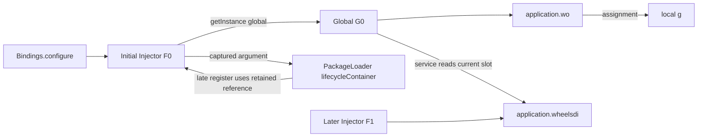

# Wheels relationship creation and lifetime

Research checkpoint: 2026-10-09. Documentation and read-only surveys only.
This extends DI-RULES-RESEARCH.md with the creation order and object lifetimes
behind actual unresolved receivers. Source observations and deductions are
labelled; no CFML runtime experiment or new resolution result is claimed.

All framework paths below are relative to
`/Users/garethedwards/corpus/cfwheels_cfwheels`.

## Creation sequence recovered from executable bodies

| Phase | Executed relationship | Evidence | Boundary still to establish |
|---|---|---|---|
| Application construction | Parent declarations supply mappings, settings and lifecycle methods | public/Application.cfc:18–27; vendor/wheels/tests/Application.cfc; public/ApplicationProxy.cfc | Runtime parent lookup and the effective application identity under the test runner |
| Factory construction | Injector receives wheels.Bindings, stores itself in application.wheelsdi, and calls binder.configure(this) | public/Application.cfc:137; vendor/wheels/Injector.cfc:60–64 | Competing constructors and writes to the application slot |
| Initial registration | global is mapped to wheels.Global | vendor/wheels/Bindings.cfc:9–12 | Later rebindings affect later retrieval, not the earlier stored object |
| Shared object construction | getInstance(global) constructs Global and application.wo stores that result | public/Application.cfc:140; Injector.cfc:159–254 | Reachable writes to wo and its member slots |
| Event startup | A separately constructed onapplicationstart object receives $init(this) | public/Application.cfc:143; events/onapplicationstart.cfc:9–17 | The keys loop writes application[key]; this is an indirect writer beyond literal assignments |
| Service configuration | General services include executes, followed by an environment-specific include | events/onapplicationstart.cfc:377–382 | Environment selection, included code and its reachable mutations |
| Plugin lifecycle | $loadPlugins invokes all selected plugin register calls, then their boot calls | events/onapplicationstart.cfc:413–415; Global.cfc:3706–3711 | Enable flags, discovery/selection and provider bodies |
| Package lifecycle | $loadPackages invokes its register and boot phases; lazy packages can join later | events/onapplicationstart.cfc:418–420; Global.cfc:3804–3806; PackageLoader.cfc:656–706 | Lazy activation time and retained container references |
| Method assembly | Global's constructor includes application helpers; WheelsTest later copies eligible UDFs from wo | Global.cfc:4730–4746; WheelsTest.cfc:12–38 | Included declarations, collision rules and object state at the copying moment |
| Local receiver | A test assigns g = application.wo before closures invoke methods on g | tests/specs/global/urlforSpec.cfc:5, :33 and :36 | Closure capture, scope ownership, shadowing and subsequent writes |

Order comes from the inspected bodies, not from prose lifecycle comments. In
this source, user services load before plugin and package registration. Plugins
boot before package registration begins; there is no single combined barrier
where every plugin and package first registers and only then all boot.

Config includes execute through Global.$includeConfig:237–279. Missing optional
service files are skipped by FileExists; an included file that fails compilation
or execution is rethrown as a startup failure. It cannot be treated as a
successful startup with an empty registration table. The general services file
is absent in this extracted checkout. That observation does not establish the
absence of service registration in another application's deployment.

## Distinguish live slots from objects captured earlier

Use explanatory object names F0, G0 and F1; these are research notation, not a
proposed resolver API.

Deductions from the source:

- Injector.init self-registers even when a caller stores the new object only in
  a local test variable. The application factory slot can therefore change
  without an explicit application.wheelsdi assignment in that caller.
- Already-created wo and g still refer to their earlier object unless separately
  reassigned. Rebinding global does not rewrite those references.
- Global.service and Global.injector read application.wheelsdi when called
  (Global.cfc:1465–1494). An older Global can consequently use a newer container.
- PackageLoader captures the container in $invokeServiceProviderRegister:937.
  If lifecycleBooted is true, late lazy instantiation calls register on that
  retained container and boot on its retained application reference (:687–694).
  It need not use the container currently in application.wheelsdi.
- Direct getInstance allows an unmapped path, while Global.service first checks
  containsInstance. The helper has stricter eligibility than its underlying
  factory. Return inference must follow that wrapper's actual checks.

These are distinguishable counterexample scenarios, not runtime-confirmed
outcomes for arbitrary engine reference semantics. A fixture should create F0,
capture it in the loader, replace the live slot with F1, then activate a lazy
provider and inspect both mapping tables and a pre-existing Global's service
lookup. This would test several relationships together without changing clif.

## Failure does not establish rollback of external side effects

Plugins.$invokeServiceProviderRegister:547–563 catches each provider failure and
drops its service-provider key. $dropServiceProvider:602–607 only updates that
array. PackageLoader.$rollbackPackage:547–590 removes package metadata, instances,
mixins, middleware and loader bookkeeping. It does not inspect or restore the
injected container's mapping table.

Source-derived counterexample: a provider performs map(name).to(path), then
throws. Its provider record can disappear while that mapping remains. The
inspected cleanup does not prove transactional binding rollback. Later provider
execution continues from a snapshot of provider keys; failure is not a reason
to disregard the provider's earlier reachable writes. Provider-specific cleanup
or other code may change this and must be examined separately.

## Object identity and method availability are different relationships

Global directly declares $setNamedRoutePositions at :1751 and URLFor at :1786.
Thus the simple g calls in urlforSpec need receiver identity and scope proof;
they do not need a copied-method rule for those two definitions.

Additional helpers have a different origin. Global includes
/app/global/functions.cfm in its pseudo-constructor, then promotes eligible
included UDFs from variables to this. The promotion checks existing public
slots; it does not replace every declared method. WheelsTest's constructor then
iterates wo members, filters non-UDFs and non-public metadata methods, and skips
names already present in variables or this before copying both slots.

This gives two receiver paths with different collision policies:

- g.someMethod calls the stored Global's method.
- someMethod() in a WheelsTest can call a reference copied earlier onto the test
  host, provided that host did not already own the name.

A later mutation of a Global member does not by itself prove that an earlier
copied test slot is refreshed. Plugin $initializeMixins has another policy:
Plugins.cfc:885–928 classifies its destination, retains a core snapshot, then
StructAppend(..., true) overwrites selected destination slots. Do not generalize
WheelsTest's skip-existing policy to plugin injection. Runtime method binding
and return-this behavior remain separately testable facts.

## Following a method return adds another selection step

Global.$createObjectFromRoot:1097–1108 computes a component from literal path
and fileName. For method=init it returns the container's getInstance result with
explicit init arguments. For another method it first obtains an instance, then
returns Invoke(instance, method, arguments). The latter result comes from the
selected method, not automatically from the constructed component.

Example: PluginMiddlewarePipelineSpec.cfc:154–155 creates Dispatch through
method=$init. Dispatch.$init:22–26 returns this, which supplies the next object
edge in that source. A similarly shaped helper calling a method that returns a
struct or another object would have a different answer. The active container's
bindings can also redirect the computed component selector.

## Corpus review and limits

Read-only survey artifact:
`target/relationship-research/wheels-lifecycle-survey.json`.

The saved pattern-final report has 2,403 findings for receiver g in 115 files.
The lexical assignment survey found one file with multiple g assignment leads:
PluginMiddlewarePipelineSpec, with two separate test closures assigning local
g. They are not conflicting writes to one proven scope. This reinforces the
need for lexical scope identity rather than file-wide assignment counting.
The survey is not a parser-based all-writer or control-flow proof; comments,
computed keys, aliases, indirect calls and mutation APIs are not closed by it.

urlforSpec has 28 archived g findings. The first reported sites are lines 32/35,
while corresponding editor lines are 33/36. Review correction: the report uses
zero-based lines and the editor uses one-based lines, so these examples agree.
They do not establish source drift. RESOLUTION-GAPS.md documents this convention;
cmd/clif/mcp_tasks.go also converts reported lines with +1. Normalize coordinates
before comparing individual calls. No new scan or resolution reduction is claimed.

Literal assignment search across this Wheels tree finds startup/error recovery,
Injector self-registration, and copies in app examples/CLI templates. It does
not close the writer set: event startup's application[key] loop, config includes,
provider calls and tests assigning application.wo[probeName] are explicit reasons
that broader closure is still unproven. $restoreTestRunnerApplicationScope:4475
restores application.wheels; it does not directly restore wo or wheelsdi.

## Review conclusions and next research

The central relationship is a history of creation, storage, reads and method
copying. A factory class and a binding name alone lose the distinction between
the object already stored, the factory currently in a live slot and the factory
retained by another object. Startup, reload/error recovery and late lazy loading
are separate paths through that history.

Before implementation, close one worked chain at a time:

1. Confirm runtime application ancestry/mappings and reconcile one current g
   call with its archived report. Review this.name: public/Application.cfc:11
   uses createUUID in this checkout; comments about a stable path hash are not
   proof of the effective application identity.
2. Audit reachable writes for that consumer, including event keys, config
   execution, test setup and factory self-registration.
3. Run the retained-container/replacement and partially failing provider
   counterexamples in a CFML runtime when available.
4. Review included-helper promotion and copied-method host behavior separately
   from the directly declared Global methods.

New evidence fingerprints (SHA-256), in addition to DI-RULES-RESEARCH.md:

Review artifact: `target/relationship-research/wheels-lifecycle-review.json`.
All fingerprints in both ledgers matched their source files; service/plugin/
package call ordering was checked against source positions. These checks verify
documentation evidence, not runtime outcomes. Preflight passed with approved
network permissions and git diff --check passed; no production checks or corpus
scan were rerun for this documentation-only checkpoint.

| File | SHA-256 |
|---|---|
| vendor/wheels/events/onapplicationstart.cfc | d3a7ca7884097450580c3d6f6d3432523eaee5bbf180a2795ad55e5fec660cd5 |
| vendor/wheels/Global.cfc | 79479347606190655ff3896d3dad97782f32497b1793c6e2889da7207511d213 |
| vendor/wheels/Plugins.cfc | ee2561d66b54184da1d703b77c1b3c26eb248587686ebbe49d2884939021019f |
| vendor/wheels/PackageLoader.cfc | e93607d0c2297fc99a3c12fbd32d918929f8c9f2aa322bd4b152814e989876e9 |
| vendor/wheels/WheelsTest.cfc | 3741c481d99d2cde07a9f20b8fdc5be130422e0da71b0f6c9a27f227df4aa82c |
